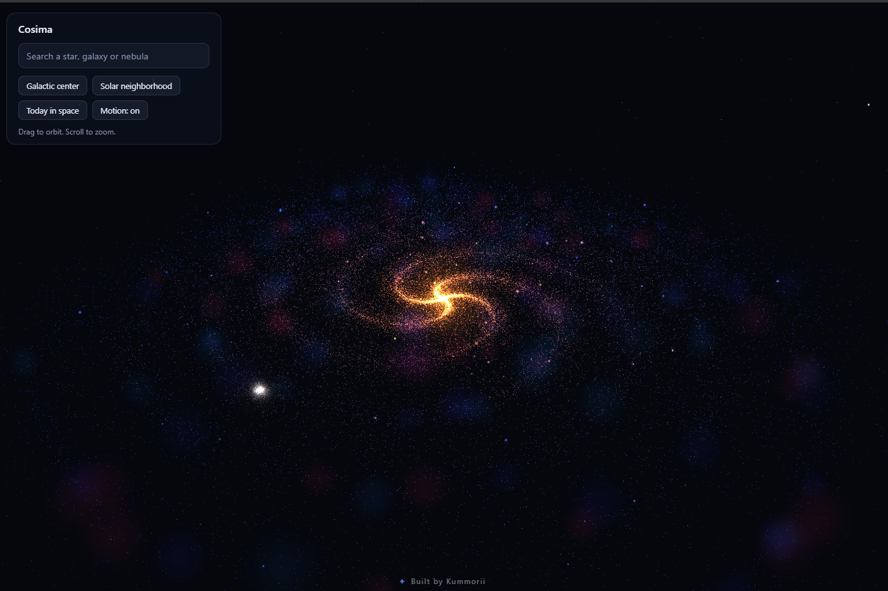
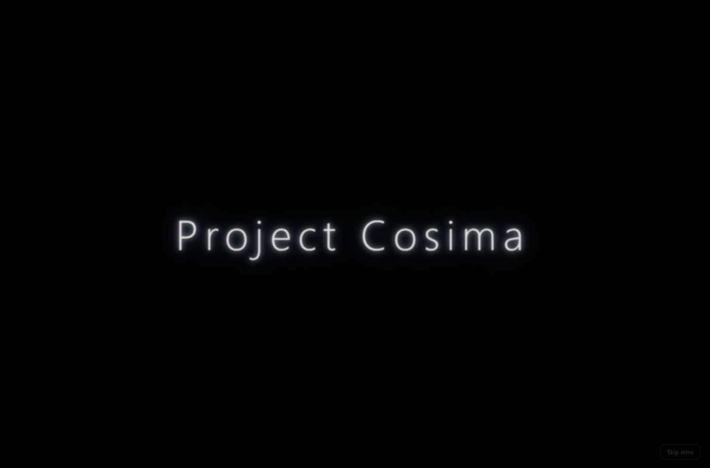
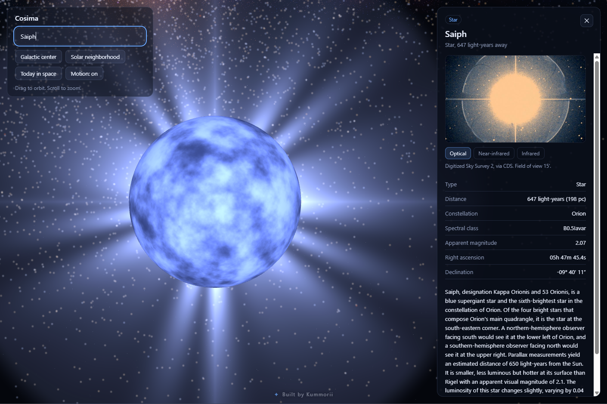

# Project Cosima

An interactive 3D map of the Milky Way. Fly to any star, galaxy or nebula, see it up close, and read about it.

**Live site: [project-cosima.vercel.app](https://project-cosima.vercel.app)**



## What it does

- **A living galaxy.** A procedural spiral of 60,000 stars that rotates, twinkles and flares, with a glowing core, drifting gas clouds, a distant starfield and the occasional shooting star. A **Motion** switch pauses all of it, and visitors who ask their system for reduced motion get a still version.
- **Real stars in their real places.** About 40,000 stars from the HYG catalog sit around the Sun at their true 3D positions, 26,700 light-years from the galactic center, colored by temperature.
- **Search and fast travel.** Type a star (instant, from a built-in list of about 460 named stars) or anything else, such as `M 31`, `Orion Nebula` or `M 87`. The name is resolved through SIMBAD, then the camera flies there along a smooth arc, however far it is.
- **A detail panel.** On arrival you get a real sky image (optical, near-infrared or infrared), the object's type, distance, coordinates and constellation, a Wikipedia summary, and links to SIMBAD and Aladin Lite.
- **Focus mode.** The background blurs and the object takes center stage as a stylized model chosen from its type: a churning star with a corona, a spiral, elliptical or irregular galaxy tilted the way it really lies in the sky, a gas cloud, or a star cluster. Drag to rotate it.
- **Today in space.** NASA's Astronomy Picture of the Day, with an automatic fallback to the NASA Image and Video Library when the APOD feed is broken.
- **An intro.** A glowing title, then a star rises and lifts the curtain like a drape.

| Intro | Focus mode |
|---|---|
|  |  |

## Built with

React, TypeScript and Vite, with three.js through React Three Fiber and a lot of custom GLSL shaders. State is kept in Zustand. The site is hosted on Vercel, with four small serverless functions for the outside services.

## How it works

- **Coordinates.** Star positions are converted from equatorial to galactic coordinates and placed relative to the galactic center, so the real catalog lines up with the procedural galaxy. The same conversion places any object found through search.
- **Distances.** SIMBAD's measured distances come first, then parallax, then redshift through Hubble's law. If none exist, the object is shown at a fixed distance and the panel says so.
- **Everything on the GPU.** Rotation, twinkling and flares run in vertex shaders, so tens of thousands of stars cost very little.
- **The outside services** (name resolver, SIMBAD, NASA) are reached through functions in `api/`, so the browser only ever talks to the site itself. The NASA key stays on the server. While developing, a proxy in `vite.config.ts` does the same job.

## Run it locally

```bash
npm install
npm run dev
```

Optionally create a `.env.local` file with a free key from [api.nasa.gov](https://api.nasa.gov) for the picture of the day. Without one, it uses NASA's shared `DEMO_KEY`, which is heavily rate-limited.

```
NASA_API_KEY=your_key_here
```

To rebuild the star catalog from the source data: `node scripts/build-stars.mjs`.

## Project layout

| Path | What is in it |
|---|---|
| `src/` | The app: the galaxy, camera, search, detail panel, focus-mode visuals, intro |
| `api/` | Serverless functions for the name resolver, SIMBAD, NASA APOD and the NASA image library |
| `public/data/` | The star catalog, built from HYG by `scripts/build-stars.mjs` |
| `docs/` | Screenshots |

## Known limits

- The galaxy is stylized. Only the stars around the Sun are real data.
- Focus-mode models are illustrations chosen from an object's type, not images of it. The sky image in the panel is the real one.
- Sky images of a few very bright stars come back noisy from the survey. The other wavelengths usually work.

## Credits and data sources

| Source | Used for |
|---|---|
| [SIMBAD](https://simbad.cds.unistra.fr) and its name resolver, from CDS, Strasbourg | Object lookup, types, distances and shapes. This work has made use of the SIMBAD database, operated at CDS, Strasbourg, France. |
| [HYG star database](https://github.com/astronexus/HYG-Database) by David Nash | The real star catalog (CC BY-SA 4.0) |
| Digitized Sky Survey 2, 2MASS and AllWISE, through CDS hips2fits | Sky images |
| [Wikipedia](https://www.wikipedia.org) | Object descriptions (CC BY-SA 4.0) |
| NASA [Astronomy Picture of the Day](https://apod.nasa.gov) and [Image and Video Library](https://images.nasa.gov) | Today in space |

This is an independent project and is not affiliated with NASA or CDS.

---

Built by [Kummorii](https://github.com/Kummorrii).
